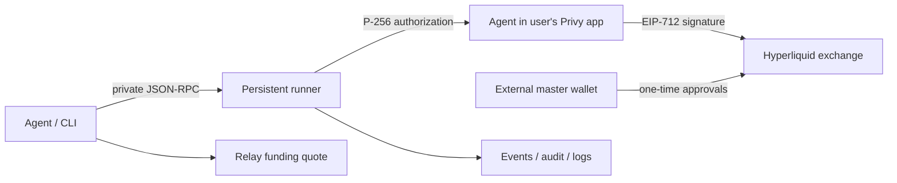

# agent-cli

An agent-native Hyperliquid trading CLI with JSON input/output, a persistent
signing runner, Privy managed agents, Relay funding, a packaged agent skill,
and a paper trading mode that runs against real mainnet market data.

Install: `npm i -g @bloxwap/agent-cli` or `bunx @bloxwap/agent-cli --help`.
The requested Hyperliquid SDK declares Node **22.12+**; use that supported runtime
or current Bun. No postinstall script. Publishing is release-gated.

## Paper trading

Paper mode simulates every trade against **real mainnet Hyperliquid public
market data** (info `l2Book`, WS `l2Book`/`trades`/`bbo`, `meta`, funding) and
never signs or submits anything. No Privy session, `approveAgent`, or deposit is
needed. Enable it per command with the global `--paper` flag, persistently with
`config set mode paper`, or for the runner with `run --paper`:

```sh
node packages/agent-cli/dist/cli.js paper reset --yes
node packages/agent-cli/dist/cli.js order --paper --json '{"coin":"BTC","side":"buy","size":"0.001","type":"market"}'
node packages/agent-cli/dist/cli.js positions --paper
node packages/agent-cli/dist/cli.js paper summary   # PnL, fees, funding, trades
```

The local simulator fills market/IOC orders by walking the live book with
slippage, rests limits until the market trades through them, supports
reduce-only and TP/SL, charges Hyperliquid taker/maker fees plus the 1 bp
Bloxwap builder fee, accrues funding, and approximates margin and liquidation
with cross/isolated leverage. State lives under `~/.bloxwap/paper/` and
survives restarts; `paper reset` clears it. Every output envelope and event is
labeled `mode`/`paper`, paper state is fully separated from live state, and
switching back with `config set mode live` requires an explicit `--yes`.
Start agents in paper mode, then fund and go live only after the strategy is
proven. See [docs/paper.md](docs/paper.md).

## Testnet quickstart

Create your own [Privy account and app](https://dashboard.privy.io/) first.
Use your app ID and secret on your machine or infrastructure you control.
Bloxwap does not provide a shared Privy app, receive these credentials, or operate
a hosted signing service. Keep the master wallet separate from the Privy agent.

```sh
npm ci
npm run build
node packages/agent-cli/dist/cli.js --help
node packages/agent-cli/dist/cli.js config set privyAppId YOUR_APP_ID
node packages/agent-cli/dist/cli.js config set privyAppSecretRef env:BLOXWAP_PRIVY_APP_SECRET
# Set your own app's BLOXWAP_PRIVY_APP_SECRET locally, outside the conversation.
node packages/agent-cli/dist/cli.js init --network testnet --master-address 0xYOUR_MASTER_ADDRESS
# Sign returned EIP-712 approval externally, then submit its 65-byte signature:
node packages/agent-cli/dist/cli.js init --network testnet --signature 0xYOUR_SIGNATURE
# Fund only with a supported test origin chain/token; inspect schema fund.
# Chain 42161 and the default origin token are mainnet values.
# Show QR/address and exact origin token/fees to user; complete any deposit steps.
node packages/agent-cli/dist/cli.js status --network testnet
# Continue only when active deposits report settled.
node packages/agent-cli/dist/cli.js run --network testnet --detach
node packages/agent-cli/dist/cli.js market --coin BTC
node packages/agent-cli/dist/cli.js order --json '{"coin":"BTC","side":"buy","size":"0.001","price":"20000","tif":"Gtc"}'
node packages/agent-cli/dist/cli.js events --follow
```

Testnet onboarding/trades require Privy sandbox credentials, an externally signed
testnet master approval and testnet collateral. Relay HyperCore testnet routes may
be unavailable; the e2e suite mocks Relay. The placeholders above must be replaced
with addresses/signatures from your test environment. Never paste a private key.

## Architecture and custody



You own the Privy account/app. Privy manages the separate agent wallet key in
that app; its P-256 authorization key stays on your machine or infrastructure.
Your master key stays in your external wallet. Bloxwap never receives or stores
these keys, your Privy app secret, or your authorization key on Bloxwap servers.
The CLI talks directly to Privy, Hyperliquid, and Relay. Hyperliquid agent
permissions prevent withdrawals from the master account. Privy policies restrict
the visible signing envelope; local checks enforce configured risk limits.
Read [custody limits](docs/custody.md) before using a funded account.

State: `~/.bloxwap`; config: `~/.bloxwap/config.json`; IPC:
`~/.bloxwap/run.sock`; env prefix: `BLOXWAP_`. All local state is private to the OS
user. The default Bloxwap builder address is
`0x71b09A08257078A4d642F7Dd7315e656c837329a`, with `f=10` (0.01%).
Override via `config set builder.address` / `config set builder.fee` or
`BLOXWAP_BUILDER_ADDRESS` / `BLOXWAP_BUILDER_FEE`; init requests builder approval.

## Development and docs

`npm run build`, `npm run lint`, `npm run typecheck`, `npm test` must pass before
committing. Unit tests mock services. `npm run test:sandbox` requires an explicit
opt-in and credentials for your own test app; missing prerequisites fail before
any request. `npm run test:e2e` is separately credential-gated. The master-key
testnet harness is CI-only; unit tests never access the network.

The npm workspace keeps the publishable CLI in `packages/agent-cli` and the
Fumadocs app in `apps/docs`. Use Node.js **24+** for repository development.
The published CLI still supports Node.js **22.12+**.

Type checking uses [tsrs](https://github.com/oxc-project/tsrs), the Rust port of
TypeScript 7, pinned to `0.18.0-ts7.1.0-dev.20260929`. The shared wrapper uses its
native binary on macOS arm64 and Linux x64/arm64 (glibc or musl), and automatically
falls back to `tsc` on Windows, Intel Macs, or when the native binary is unavailable.
TypeScript `^7.0.2` remains installed for the fallback. Run `npm run typecheck:tsc`
and `npm run docs:check:tsc` to check explicitly with tsc, or set `TYPECHECK=tsc`
for the normal check/build scripts. CLI bundling still uses tsup/esbuild.
The lockfile also retains TypeScript 6.0.3 for tsup and typescript-eslint peers
that need the JavaScript compiler API; workspace fallback checks use TypeScript 7.0.2.
Docs builds run `next typegen` and the wrapper with `--noEmit` before `next build`;
Next's duplicate type check is disabled. See the [development guide](apps/docs/content/docs/development.mdx).

```sh
npm ci
npm run docs:dev       # http://localhost:3903/
npm run docs:build     # static export at apps/docs/out
npm run docs:check
npm run docs:preview   # previews the export at port 3903
npm run pack:cli       # packs only @bloxwap/agent-cli
```

The site defaults to the host root; the docs are under `/docs/`. Pages CI sets
`NEXT_PUBLIC_BASE_PATH=/agent-cli` for its deployment, builds and checks pull
requests, and deploys main. Command schemas and the skill guide are generated
from the CLI with `npm run docs:generate` and before docs builds.
Agents can fetch the same packaged skill as plain Markdown at
[SKILL.md](https://bloxwap.github.io/agent-cli/SKILL.md).

[Docs index](docs/index.md), [security](docs/security.md),
[error catalog](docs/errors.md), and [SKILL.md](packages/agent-cli/SKILL.md) remain
available as repository Markdown. See [docs app README](apps/docs/README.md).
