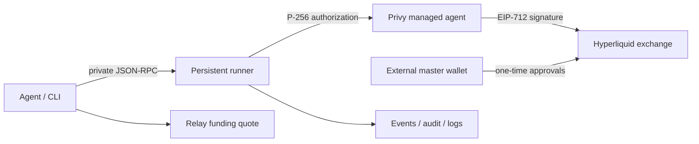

# agent-cli

An agent-native Hyperliquid trading CLI with JSON input/output, a persistent
signing runner, Privy managed agents, Relay funding, and a packaged agent skill.

Install: `npm i -g @bloxwap/agent-cli` or `bunx @bloxwap/agent-cli --help`.
The requested Hyperliquid SDK declares Node **22.12+**; use that supported runtime
or current Bun. No postinstall script. Publishing is release-gated.

## Testnet quickstart

```sh
npm ci
npm run build
node packages/agent-cli/dist/cli.js --help
node packages/agent-cli/dist/cli.js config set privyAppId YOUR_APP_ID
node packages/agent-cli/dist/cli.js config set privyAppSecretRef env:BLOXWAP_PRIVY_APP_SECRET
# Set BLOXWAP_PRIVY_APP_SECRET securely outside the CLI/conversation.
node packages/agent-cli/dist/cli.js init --network testnet --master-address 0xYOUR_MASTER_ADDRESS
# Sign returned EIP-712 approval externally, then submit its 65-byte signature:
node packages/agent-cli/dist/cli.js init --network testnet --signature 0xYOUR_SIGNATURE
# Fund only with a supported test origin chain/token; inspect schema fund.
# Chain 42161 and the default origin token are mainnet values.
# Show QR/address and exact origin token/fees to user; complete any deposit steps.
node packages/agent-cli/dist/cli.js status --network testnet
# Continue only when active deposits report settled.
node packages/agent-cli/dist/cli.js run --network testnet --detach
node packages/agent-cli/dist/cli.js market --coin BTC
node packages/agent-cli/dist/cli.js order --json '{"coin":"BTC","side":"buy","size":"0.001","price":"20000","tif":"Gtc"}'
node packages/agent-cli/dist/cli.js events --follow
```

Testnet onboarding/trades require Privy sandbox credentials, an externally signed
testnet master approval and testnet collateral. Relay HyperCore testnet routes may
be unavailable; the e2e suite mocks Relay. The placeholders above must be replaced
with addresses/signatures from your test environment. Never paste a private key.

## Architecture and custody



Master custody stays external. Privy owns the separate agent key; the CLI holds
only an authorization key. Hyperliquid agent permissions deny withdrawal.
Privy policies restrict signing domains; local checks enforce configured risk
limits. Read [custody limits](../../docs/custody.md) before using a funded account.

State: `~/.bloxwap`; config: `~/.bloxwap/config.json`; IPC:
`~/.bloxwap/run.sock`; env prefix: `BLOXWAP_`. All local state is private to the OS
user. The default Bloxwap builder address is
`0x71b09A08257078A4d642F7Dd7315e656c837329a`, with `f=10` (0.01%).
Override via `config set builder.address` / `config set builder.fee` or
`BLOXWAP_BUILDER_ADDRESS` / `BLOXWAP_BUILDER_FEE`; init requests builder approval.

## Development and docs

Use Node.js 24+ and run build, lint, typecheck and tests from the workspace root.
See the [repository README](../../README.md) and [docs app](../../apps/docs/README.md).
The packaged [SKILL.md](SKILL.md) documents the authorized agent workflow.
