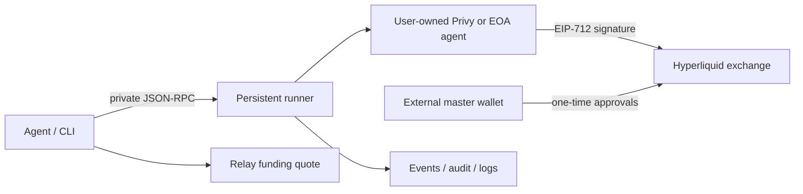

# agent-cli

An agent-native Hyperliquid trading CLI with JSON input/output, a persistent
signing runner, user-owned Privy or EOA agents, Relay funding, a packaged agent skill,
and a paper trading mode against real mainnet market data.

After the first public release, install with `npm i -g @bloxwap/agent-cli` or run
`bunx @bloxwap/agent-cli --help`. Use Node **22.12+** or Bun;
`bunx --bun @bloxwap/agent-cli --help` explicitly selects Bun.
The package has no install lifecycle scripts and supports `--ignore-scripts`.
Until publication, build a local tarball with `npm run build && npm run pack:cli`
from the repository root and install that tarball with `npm i -g PATH_TO_TARBALL`.

## Paper trading

Simulate strategies against real mainnet Hyperliquid market data with no
signing and no funds: `paper reset --yes`, then trade with the global `--paper`
flag (or `config set mode paper` / `run --paper`). The simulator walks the live
book, charges Hyperliquid taker/maker plus the optional builder fee (zero by
default), accrues funding, approximates margin/liquidation, and keeps restartable state under
`~/.bloxwap/paper/`. `paper summary` reports PnL, fees, funding and trades.
Envelopes and events carry `mode`/`paper` labels; `config set mode live --yes`
is the explicit way back to live. See `docs/paper.md`.

## Testnet quickstart

Use your own Privy app or a dedicated EOA agent. No wallet or credentials are
bundled. Set secrets locally outside the CLI/conversation, then configure only
their references:

```sh
npm ci
npm run build
# Privy:
node packages/agent-cli/dist/cli.js config set signerType privy
node packages/agent-cli/dist/cli.js config set privyAppId YOUR_APP_ID
node packages/agent-cli/dist/cli.js config set privyAppSecretRef env:BLOXWAP_PRIVY_APP_SECRET
# Or a user-provided EOA agent (BLOXWAP_EOA_KEY is set locally):
node packages/agent-cli/dist/cli.js config set signerType eoa
node packages/agent-cli/dist/cli.js config set eoaKeyRef env:BLOXWAP_EOA_KEY

node packages/agent-cli/dist/cli.js init --network testnet --master-address 0xYOUR_MASTER_ADDRESS
# Sign the returned agent approval externally and resume init.
# Init applies the BLOXWAP referral if the account has none.
node packages/agent-cli/dist/cli.js status --network testnet
node packages/agent-cli/dist/cli.js run --network testnet --detach
```

Testnet onboarding requires your selected signer, external master approvals and
testnet collateral. The EOA must be separate from the master wallet. Never put a
private key, seed, or app secret in CLI input. Replace all placeholders with your
own values. Read [custody limits](../../docs/custody.md) before funding.

## Architecture and custody



Master custody stays external. The user owns the Privy app or local EOA agent key.
Hyperliquid agent permissions deny withdrawal. Local typed-data and risk checks
apply to both signer types; Privy policies add remote restrictions for Privy agents.

State: `~/.bloxwap`; config: `~/.bloxwap/config.json`; IPC:
`~/.bloxwap/run.sock`; env prefix: `BLOXWAP_`. All local state is private to the OS
user. The default Bloxwap builder address is
`0x71b09A08257078A4d642F7Dd7315e656c837329a`, with `f=0` (no added fee).
The default `BLOXWAP` referral is applied during approved onboarding when the
account has no referral. Optional non-zero builder fees remain configurable and
require master approval.

## Development and docs

Use Node.js 24+ and run build, lint, typecheck and tests from the workspace root.
See the [repository README](../../README.md) and [docs app](../../apps/docs/README.md).
The packaged [SKILL.md](SKILL.md) documents the authorized agent workflow.
